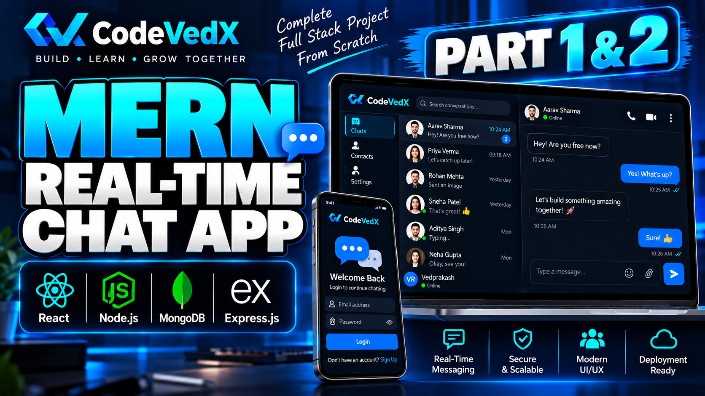

# ✨ Full Stack Realtime Chat App ✨

A modern **real-time chat application** built with the MERN stack, Socket.io, TailwindCSS, and DaisyUI.



[Video Tutorial on Youtube](https://www.youtube.com/watch?v=nf_cw6HoW3k&list=PLdpKm2b-CQRM)

## 🚀 Highlights

* 🌟 **Tech Stack:** MERN + Socket.io + TailwindCSS + DaisyUI
* 🎃 **Authentication & Authorization** using JWT
* 👾 **Real-time messaging** with Socket.io
* 🚀 **Online user status**
* 👌 **Global state management** with Zustand
* 🐞 **Error handling** on both the server and client
* ⭐ **Deployment** with a production-ready setup
* ⏳ And much more!

## ⚙️ Setup `.env` File

Create a `.env` file in the project root and add the following environment variables:

```env
MONGODB_URI=...
PORT=5001
JWT_SECRET=...
CLOUDINARY_CLOUD_NAME=...
CLOUDINARY_API_KEY=...
CLOUDINARY_API_SECRET=...
NODE_ENV=development
```

## 🛠️ Build the App

```bash
npm run build
```

## ▶️ Start the App

```bash
npm start
```

## 📌 Developed by

**CodeVedX**

Building practical projects and helping developers learn modern web development.
